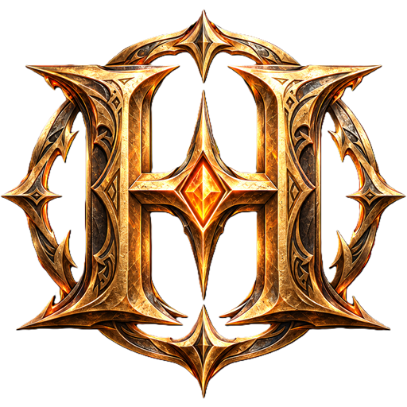

<p align="center">
  
</p>

<h1 align="center">HomeFrontier</h1>

<p align="center">
  <strong>Monster Hunter Frontier ZZ en solo, hors ligne, en français.</strong><br>
  Un serveur Erupe local, une base PostgreSQL portable, la traduction française du jeu et un launcher Rust.
</p>

> **English summary.** HomeFrontier is an offline, single-player package for Monster Hunter Frontier ZZ: a
> local [Erupe](https://github.com/Mezeporta/Erupe) server with a portable PostgreSQL database, a Rust (egui)
> launcher that starts everything, manages accounts and boots the game without Internet Explorer, and a French
> translation of the client and of the server-side quests. The launcher interface is available in French,
> English and Japanese. **No Capcom file is included**: you need your own MHF-ZZ client and quest data.

Projet en cours de développement (version 0.1). Sur le modèle de
[HomeCraft Edition Vanilla](https://github.com/BlaMacfly/HomeCraft-Vanilla).

## Ce que fait le launcher

| Onglet | Fonction |
|---|---|
| **Jouer** | démarre PostgreSQL puis Erupe (tout sur 127.0.0.1), connexion au compte, choix ou création du personnage, bouton JOUER |
| **Comptes** | liste des comptes et de leurs personnages, création de comptes |
| **Serveur** | serveur local (solo, ou ouvert au réseau local) ou serveur Erupe distant ; adresse et ports réglables |
| **Français** | applique ou retire la traduction française du client, avec sauvegarde des fichiers d'origine |

Le jeu est lancé directement par [mhf-iel](https://github.com/rockisch/mhf-iel) (32 bits) : ni `mhf.exe`, ni
`mhl.dll`, ni Internet Explorer, ni GameGuard. L'interface du launcher est en français, en anglais ou en japonais.

## Traduction

| Partie | Source | État |
|---|---|---|
| Client (objets, armes, armures, compétences, interface) | [MHFrontier-Translation](https://github.com/Mogapedia/MHFrontier-Translation) v0.3.0 (Mogapédia, GPL-3.0), téléchargée à part | 63 218 chaînes appliquées |
| Quêtes (titres, objectifs, conditions, commanditaires, descriptions) | `Localization/quetes-fr.tsv` (ce dépôt) | lot pilote : 132 textes, 61 % des occurrences |
| Scénarios et dialogues | — | à faire |

La police du jeu ne contient pas de lettres accentuées : les accents sont remplacés (« é » → « e ») en attendant
une police modifiée.

## Ce que ce dépôt ne contient pas

- le client Monster Hunter Frontier ZZ et ses fichiers (`Client/`) ;
- les fichiers de quêtes, scénarios et événements du serveur (`Server/bin/`) ;
- les composants tiers, téléchargés et vérifiés par empreinte SHA-256 d'après `Build/manifest.json` : Erupe,
  PostgreSQL, traductions MHFrontier-Translation ;
- vos données (`UserData/` : base, comptes, réglages, sauvegardes).

## Construire

Prérequis : Windows 10/11, `rustup` (stable, plus nightly `i686-pc-windows-msvc` pour mhf-iel), Visual Studio
Build Tools 2022.

```powershell
# Composants tiers (Erupe, PostgreSQL, traductions) dans le dossier d'installation
powershell -File Build\Get-Components.ps1 -Root C:\Jeux\HomeFrontier

# Launcher
cd Launcher
cargo build --release
```

Le dossier d'installation doit avoir un chemin sans accent : le jeu lit ses chemins en Shift-JIS.

## Documentation

- [Audit et plan](Documentation/01-Audit.md) : composants, encodage, couverture de la traduction, compatibilité
  avec le matériel actuel, phases.
- [Étude des bots](Documentation/02-Etude-Bots.md) : ce qu'Erupe permet de simuler.

## Crédits et licences des composants

- [Erupe](https://github.com/Mezeporta/Erupe) (MIT) : serveur de jeu.
- [mhf-iel](https://github.com/rockisch/mhf-iel) (MIT) : lancement du jeu.
- [mhf-outpost](https://github.com/Mogapedia/mhf-outpost) (MIT) : code ECD, JKR et tables de pointeurs repris
  dans `Launcher/src/frontier_text/` (licence jointe).
- [MHFrontier-Translation](https://github.com/Mogapedia/MHFrontier-Translation) (GPL-3.0) : traduction du
  client, non incluse, téléchargée par `Build/Get-Components.ps1`.
- [Cinzel](https://github.com/NDISCOVER/Cinzel) (SIL OFL 1.1) : police du titre.
- PostgreSQL (licence PostgreSQL).

Monster Hunter et Monster Hunter Frontier sont des marques de Capcom Co., Ltd. HomeFrontier est un projet
indépendant, sans lien avec Capcom.
